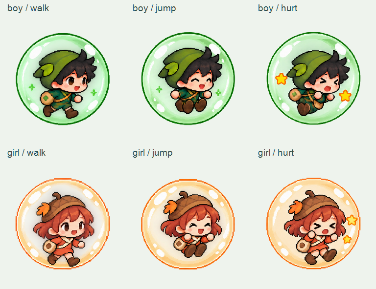

# Woodland Scouts

Two chibi woodland adventurers inside enchanted balls: a black-haired boy in green and an auburn-haired girl in orange. Artwork only, with no game scripts or Unity project files.

## Individual frames

Download the [60-frame PNG pack](https://github.com/Zeref538/Woodland-Scouts/releases/download/v1.0.0/Woodland-Scouts-60-frames.zip) for the smaller lab download.

| Character | Animation | Folder | Frames |
|---|---|---|---|
| Boy | Walking | frames/boy/walk | 10 |
| Boy | Jumping | frames/boy/jump | 10 |
| Boy | Hurt | frames/boy/hurt | 10 |
| Girl | Walking | frames/girl/walk | 10 |
| Girl | Jumping | frames/girl/jump | 10 |
| Girl | Hurt | frames/girl/hurt | 10 |

Each frame is a separate transparent 256x256 PNG, numbered 01 through 10. Frames face right. Play them in numerical order; 10 frames per second is the preview speed. Walking loops; jumping and hurt are one-shot sequences for later game integration.

## Alignment and checks

Frames were cut around detected artwork boundaries rather than an assumed grid. Each ball was scaled uniformly to a nominal 192-pixel diameter, centered horizontally and aligned to the same lower baseline. Nearest-neighbor scaling preserves pixel edges. No frame was stretched independently in width or height.

All 60 PNGs decode successfully. Every animation contains 10 distinct frames. All canvases are 256x256, outer edges are fully transparent, visible artwork stays inside the canvas, and measured ball bounds share the same horizontal center within two pixels. These are artwork checks, not an in-game animation test.

`previews/` contains six animated WebP previews and the sample overview. `sources/` preserves the six new sheets and both original sheets. The combined Git history includes the original boy and girl repositories.

## Tilt Rivals

See the [Tilt Rivals artwork guide](tumble/README.md) for the newer game's character frames, arena artwork, and clone/update commands.
